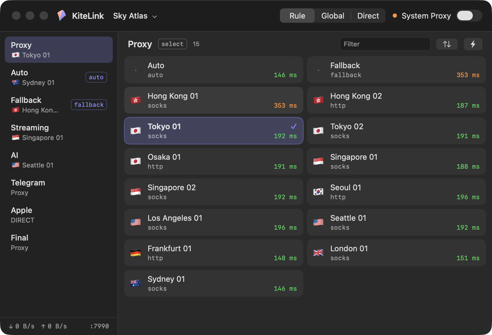

<p align="center"></p>
<h1 align="center">KiteLink</h1>
<p align="center">A native proxy client for Clash / mihomo profiles.<br><b>Paste a link, pick a node, fly.</b></p>

<p align="center"></p>

KiteLink is a small, native front end for the [mihomo](https://github.com/MetaCubeX/mihomo) core. It reads the same
subscriptions and profiles as Clash Verge Rev, and is built around the two things most people actually do with a
proxy client: **import a subscription** and **choose a node**. Everything else stays out of the way until you look
for it.

- **macOS** — SwiftUI, in this repository today (`macos/`), Apple silicon, macOS 14+
- **iOS, Windows, Linux, Android** — planned as native apps in this same repository, sharing the profile format,
  the override format and the design

## What it does

| | |
|---|---|
| **One step to a working proxy** | Paste a subscription link (or open a `clash://install-config?url=…` link, or drop a `.yaml` file) and the node list is on screen about a second later. |
| **Bring your setup** | *Import from Clash Verge Rev* copies its subscriptions, usage and node choices in one click, offline, without changing anything over there. |
| **Nodes at a glance** | Groups on the left, nodes on the right as a grid with flag, protocol and latency — two columns in the smallest window, more as it widens. Latency is tested on its own the first time a group is shown; click a node to use it. The group list can be dragged narrower or wider and remembers its width. |
| **Lives in the menu bar** | The kite in the menu bar has the switch, the mode (Rule / Global / Direct), every group with its nodes, and the profile switch. The window is optional. |
| **Polite system proxy** | Switching System Proxy off (or quitting) puts back whatever proxy settings the Mac had before, so KiteLink can sit next to another client or a company proxy. |
| **Subscriptions that keep themselves fresh** | Honours `profile-update-interval`, shows quota and expiry from `subscription-userinfo`, opens the provider's panel from `profile-web-page-url`. |
| **Every mihomo protocol** | The bundled core is stock mihomo: Shadowsocks, VMess, VLESS, Trojan, Hysteria 2, TUIC, AnyTLS, Mieru, WireGuard… and select / url-test / fallback / load-balance groups. |

## When you want more

The simple path does not take the advanced one away.

- **Overrides** — a YAML file merged on top of a profile, per profile or global. It uses the Clash Verge Rev *Merge*
  convention, so an existing file drops in: a top-level key replaces the profile's, and `prepend-rules`,
  `append-rules`, `prepend-proxies`, `append-proxies`, `prepend-proxy-groups`, `append-proxy-groups` splice into those
  lists. The result is checked with `mihomo -t` before it is applied.

  ```yaml
  prepend-rules:
    - DOMAIN-SUFFIX,example.com,DIRECT
  dns:
    enable: true
    enhanced-mode: fake-ip
  ```
- **Settings** — mixed port, LAN access, controller port, bypass list, log level, IPv6, latency test URL,
  subscription User-Agent (global or per profile), fetch-through-proxy per profile.
- **Console** (⌥⌘C) — live core logs and the connection table.
- **Shell** — click the port in the window footer (or *Copy Shell Proxy Command* in the menu bar) for the
  `export https_proxy=…` line.
- **The files are yours** — everything is plain files in `~/Library/Application Support/KiteLink/`
  (see [docs/DESIGN.md](docs/DESIGN.md)); the generated `core/config.yaml` is exactly what mihomo runs.

Not in 0.1: TUN mode (it needs a privileged helper; planned), script overrides, share-link (base64) subscriptions.

## Build

```sh
brew install xcodegen
./core/fetch.sh darwin-arm64 macos/build/core   # the pinned mihomo + geo data, sha256-checked
./macos/build.sh                                # → macos/build/KiteLink.app  (./macos/build.sh release for Release)
open macos/build/KiteLink.app
```

`./macos/package.sh` makes `dist/KiteLink-<version>-macos-arm64.dmg`. The build is ad-hoc signed; the first launch of
a downloaded copy needs right-click → Open.

Tests for the shared logic: `cd packages/KiteKit && swift test`.

## Repository

```
brand/              the mark: render.swift draws every icon size, the menu bar glyph and the SVGs
core/               which mihomo is shipped (mihomo.version) and the script that fetches and verifies it
docs/               design notes, a sample profile, screenshots
packages/KiteKit/   Swift package shared by the Apple apps: profiles, subscriptions, overrides, the mihomo API client
macos/              the macOS app (SwiftUI; project.yml → xcodegen)
```

Other platforms get their own top-level directory (`ios/`, `windows/`, …) next to `macos/`.

## Credits

KiteLink is a shell around [mihomo](https://github.com/MetaCubeX/mihomo) (GPL-3.0, run as a separate process and
distributed unmodified), with geo data from [meta-rules-dat](https://github.com/MetaCubeX/meta-rules-dat) and YAML
handling by [Yams](https://github.com/jpsim/Yams). Its profile handling follows the conventions set by
[Clash Verge Rev](https://github.com/clash-verge-rev/clash-verge-rev).

KiteLink's own code is [MIT](LICENSE).
