# KiteLink brand

<p> &nbsp;  &nbsp;  </p>

## Idea

A kite is the simplest way to reach somewhere you cannot go yourself. The mark is the kite itself and nothing else —
no line, no tail: just the sail at the moment the wind fills it. That is how the app should feel: light, already
flying, nothing to operate.

**Tagline:** Paste a link, pick a node, fly.

## Mark

The sail of a diamond kite, abstracted to two curved planes.

- **Shape.** The kite's diamond with the two leading edges bowed out by the wind and the two trailing edges drawn in,
  so it reads as cloth under tension rather than a flat rhombus. Top and bottom stay sharp.
- **Fold.** One crease down the spine splits it into a warm windward half and a cool leeward half. There are no
  outlines and no other detail.
- **Tilt.** 16° clockwise: nose up and to the right, climbing.
- **App icon.** The sail on a pale dawn sky inside the macOS rounded square (824/1024).
- **Menu bar glyph.** One colour: the two halves pulled slightly apart along the spine. Filled = proxy on; the sail's
  outline = proxy off.

`render.swift` is the source of truth: it draws every size from geometry (no scaling) and writes the Xcode asset
catalog, the PNGs here and both SVGs.

```sh
swift brand/render.swift macos/KiteLink/Assets.xcassets brand
```

## Colour — Dawn

| | Hex | Use |
|---|---|---|
| Peach | `#FFC2B0` | windward half, top |
| Rose | `#FF8FA8` | windward half, bottom |
| Lilac | `#B79CFF` | leeward half, top |
| Sky | `#6F94FF` | leeward half, bottom |
| **Dawn Violet** | `#6D74F4` (light) · `#828AFC` (dark) | the accent: selection, switches, primary buttons |
| Dawn sky | `#FFF8F3` → `#FFE3EC` | icon background, top to bottom |

In the apps, everything except the accent follows the system appearance (light and dark). The rose-to-violet sweep
appears only where something is drawn rather than a system control (the quota bar). Latency uses the system green /
orange / red — status colours are never brand colours.

## Type

The system typeface on every platform (SF Pro on Apple platforms). The wordmark is **KiteLink** — one word, capital K
and L — in the system semibold with slightly tight tracking (−0.2 at 14 pt). Numbers that change (latency, traffic,
ports) and protocol tags are monospaced.

## Voice

Plain and short. Say what happened and what to do: "Port 7890 is in use by another app. Quit it, or change the port
in Settings › Proxy." Name things the way the provider and the core do (profile, group, node, rule). No exclamation
marks, no jargon the user did not bring.

## Don'ts

- Don't add a line, a tail or an outline to the sail.
- Don't set it upright or mirror it; the tilt is the climb.
- Don't swap the halves or recolour them outside the Dawn palette (one colour is black or white only).
- Don't use the icon's background as a UI colour.
