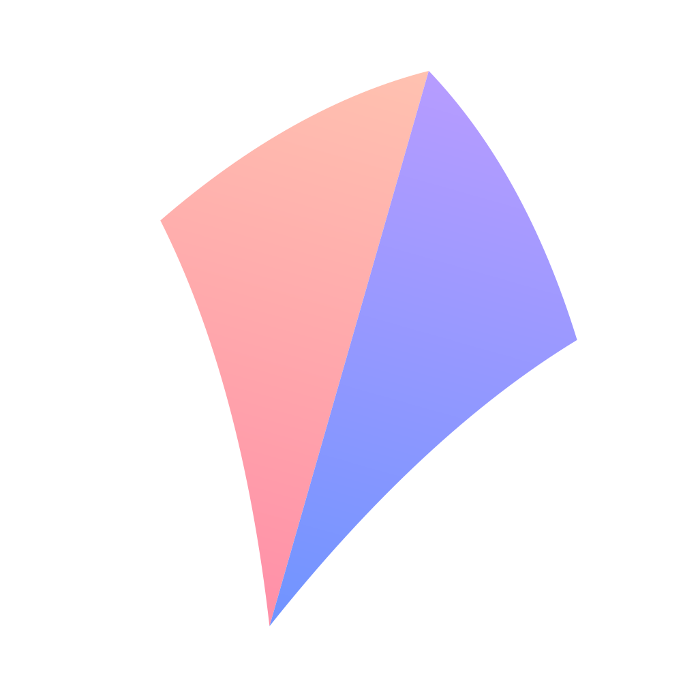

# KiteLink brand

<p> &nbsp;  &nbsp; </p>

## Idea

A kite is the simplest way to reach somewhere you cannot go yourself: you hold one end of a line, and the other end
is up in open sky. That is what the app does — one link in your hand, the open internet at the other end — and it is
how it should feel: light, one line, nothing to operate.

**Tagline:** Paste a link, pick a node, fly.

## Mark

A kite diamond tilted 16° into the wind, with its line running down to a small ring — the *link* you hold.

- The diamond is two triangles on a spine; the right face is a step darker, so it reads as folded paper, not a logo
  shape.
- The line leaves the bottom vertex and meets the ring on a tangent. Its weight is 24/1024 of the canvas.
- On the app icon the mark sits on a dusk sky inside the macOS rounded square (824/1024), with a faint warm glow
  behind the kite.
- The **menu bar glyph** is a separate, bolder drawing (wider kite, shorter line, a dot for the ring) so it holds at
  18 pt. Filled = proxy on. Outline = proxy off.

`render.swift` is the source of truth: it draws every size from geometry (no scaling) and writes the Xcode asset
catalog, the PNGs here and both SVGs.

```sh
swift brand/render.swift macos/KiteLink/Assets.xcassets brand
```

## Colour

| | Hex | Use |
|---|---|---|
| Kite Amber | `#FFC857` | top of the kite gradient |
| Kite Coral | `#FF6B4A` | bottom of the kite gradient |
| **Kite Orange** | `#F47C40` (light) · `#FF9052` (dark) | the accent: selection, switches, primary buttons |
| Line Cream | `#FFF3DC` | the line and ring |
| Dusk | `#2C3C7E` → `#0F1433` | icon background, top to bottom |
| Ink | `#0F1433` | dark surfaces in marketing |

In the apps, everything except the accent follows the system appearance (light and dark). Latency uses the system
green / orange / red — status colours are never brand colours.

## Type

The system typeface on every platform (SF Pro on Apple platforms). The wordmark is **KiteLink** — one word, capital K
and L — in the system semibold with slightly tight tracking (−0.2 at 14 pt). Numbers that change (latency, traffic,
ports) and protocol tags are monospaced.

## Voice

Plain and short. Say what happened and what to do: "Port 7890 is in use by another app. Quit it, or change the port
in Settings › Proxy." Name things the way the provider and the core do (profile, group, node, rule). No exclamation
marks, no jargon the user did not bring.

## Don'ts

- Don't put the kite upright or mirror it; the tilt is the wind.
- Don't recolour the kite outside the amber → coral gradient (mono is black or white only).
- Don't use the app-icon background as a UI colour.
